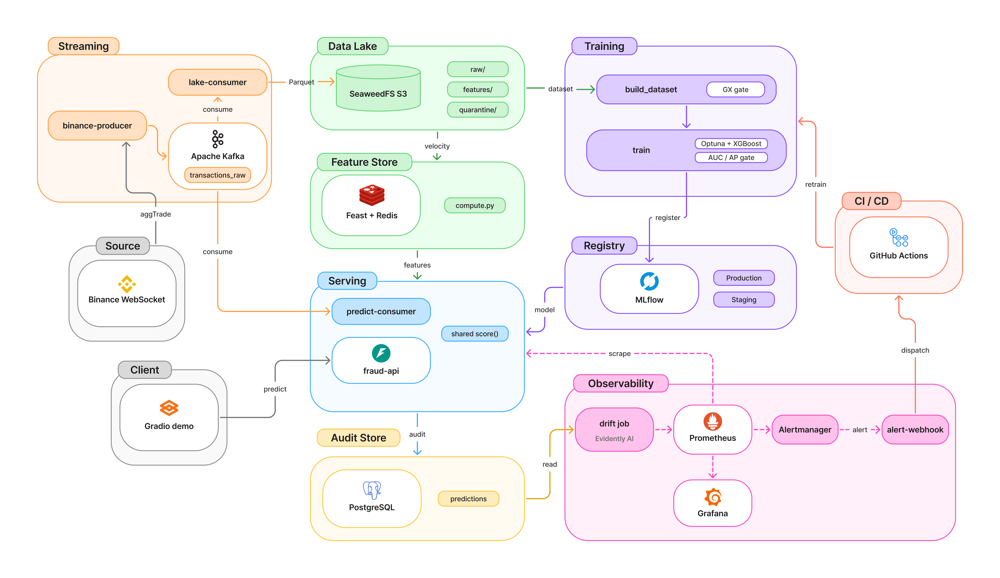

# 🚀 Real-Time Fraud Detection MLOps Platform

> **End-to-end MLOps for fraud detection: streaming ingestion, a featurised data lake, gated training, real-time serving and drift-driven retraining.**

A containerised platform that runs the whole model lifecycle: a public Binance
trade feed is streamed through Kafka into an S3-compatible lake, turned into
point-in-time velocity features with Feast, validated with Great Expectations,
trained with XGBoost + Optuna behind a quality gate, registered in MLflow,
served by FastAPI (and a Kafka consumer) through one shared scoring path, and
monitored with Evidently → Prometheus → Alertmanager → GitHub Actions.



## What it demonstrates

- **Streaming ingestion** — Binance WebSocket → Kafka → SeaweedFS, with cheap
  pre-checks that divert bad batches to `quarantine/` and offsets committed only
  after a durable write.
- **One data contract** — the same ordered feature vector (`FEATURE_COLS`) is
  built in training and serving; the prediction audit row stores exactly what
  the model scored.
- **A real gate** — Great Expectations validates the training dataset, Optuna
  tunes XGBoost, and a model that misses the AUC/PR-AUC floor is never
  registered, so it can never be promoted.
- **Honest labels** — the trade feed is unlabelled, so the demonstration trains
  on a synthetic seed; the code says so instead of pretending otherwise.
- **Promotion by hand** — training registers; only `scripts/model_ctl.py
  promote` moves a version into Staging/Production.
- **Drift that reaches a human** — Evidently measures served inputs, publishes
  `evidently_drift_share`, Prometheus alerts on it, and Alertmanager dispatches
  the retraining workflow through an authenticated webhook.

## Quick start

```bash
cp .env.example .env          # adjust if needed
make infra-up                 # store, Kafka, lake, registry, API, monitoring
make all                      # bootstrap a Production model if none exists
```

Then:

| Service | URL |
|---|---|
| Fraud API (OpenAPI docs) | http://localhost:8000/docs |
| Gradio demo | http://localhost:7860 |
| MLflow | http://localhost:5000 |
| Grafana (`admin` / `admin`) | http://localhost:3000 |
| Prometheus / Alertmanager | http://localhost:9090 · http://localhost:9093 |
| SeaweedFS master / filer | http://localhost:9333 · http://localhost:8888 |

```bash
curl http://localhost:8000/health
curl http://localhost:8000/ingest/status
docker compose -f docker/docker-compose.yml ps
```

## Documentation

| Guide | What's inside |
|---|---|
| [Architecture](docs/architecture.md) | Component map, pipeline lanes, tech stack, repository layout, data contracts |
| [Ingestion](docs/ingestion.md) | Binance producer, Kafka topic, lake consumer, quarantine, GX validation |
| [Features](docs/features.md) | Feast repository, velocity computation, online/offline stores |
| [Training](docs/training.md) | Dataset build, quality gate, Optuna/XGBoost, MLflow registry, retraining switch |
| [Serving](docs/serving.md) | API endpoints, shared scoring path, shadow routing, prediction consumer |
| [Monitoring](docs/monitoring.md) | Drift job, Prometheus rules, Grafana dashboard, alert webhook |
| [Operations](docs/operations.md) | Setup, configuration, Makefile targets, troubleshooting, deployment |
| [Testing](docs/testing.md) | Unit/integration/load suites and the CI workflows |

## Repository layout (top level)

```
api/            FastAPI app + shared scoring path
ingestion/      Binance producer, lake writer, prediction consumer
training/       Dataset build, feature contract, XGBoost training
features/       Velocity features + Feast access layer
feature_repo/   Feast definitions and store config
datalake/       S3 (SeaweedFS) access layer
gx/             Great Expectations suite and runner
monitoring/     Drift job, Prometheus/Grafana/Alertmanager config, alert webhook
db/  alembic/   Prediction audit table and migrations
docker/         Compose stack and images
scripts/        Operator CLIs and the training gate
.github/        CI/CD workflows
```

A per-directory listing lives in [Architecture](docs/architecture.md).
